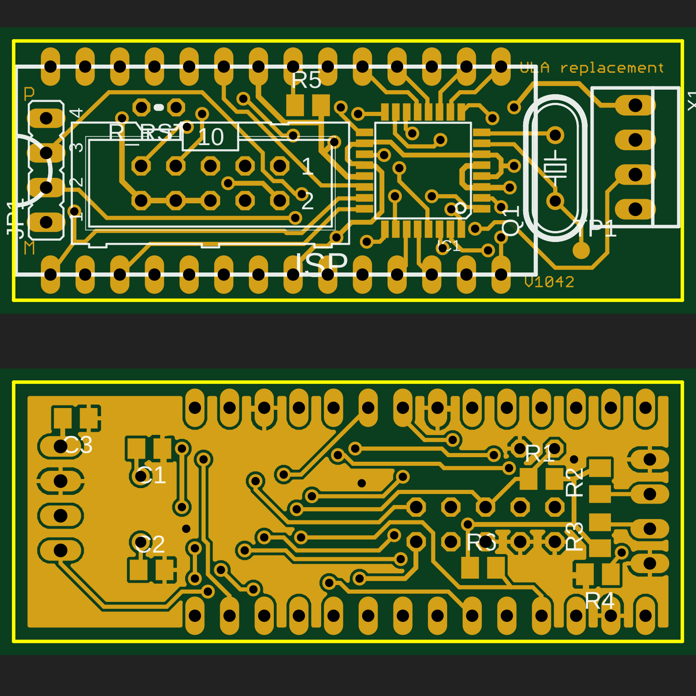

# C5 ULA replacement — firmware V1203

A replacement for the **Ferranti ULA (5G014)** control chip of the **Sinclair C5**, built on
**["ULA replacement" by Philipp Bank (cypax)](https://www.cypax.net/projects/ula/)** (2010–2011).
A small ATmega board plugs into the original 28-pin ULA socket in the pod and takes over the
LED displays, motor relay, battery/current/temperature monitoring and the buzzer.

This repository continues that project with new firmware, a fixed bootloader, support for the
**ATmega328P**, a **browser-based configurator** for any OS, and the board files in KiCad format.



> **Status:** bootloader V1044 and firmware V1202 were tested on the bench on an ATmega328P board
> (flashed, read back byte-identical, logging and serial verified). Firmware V1203 builds and passes
> the checks but hasn't been run on hardware yet. Not yet road-tested in a C5.
> The ATmega88 builds compile and pass the same checks but haven't been run on hardware.

## What's new compared to cypax V1172

**Pedal assist (pedelec)**
- Speed uses the wheel size you configure (the original always used 1280 mm).
- Hysteresis at both speed limits and a minimum relay switching time: no more relay chatter.
- Max speed `0` = no upper cut-off (motor assists at any speed while pedalling).
  A pedelec without the 25 km/h cut-off is not road-legal as a bicycle in the EU.
- Pedal sensor debounce; no phantom "pedalling" right after power-on.

**Battery (LiFePO4)**
- LiFePO4 profile (default, 12.8 V / 4 cells): LED bar and cut-off use the *resting* voltage
  (motor off for ~3 s), low-battery warning, cut-off if the voltage collapses under load.
  The original lead-acid behaviour is still available as a build option.

**Display and logging**
- Left LED bar shows **speed** (1 LED per 5 km/h) while the motor button is released,
  motor current while it is pressed.
- Clear **fault codes** (V1203): one LED per kind of fault, slow flash = warning, fast flash =
  error, buzzer in the same rhythm. All codes are in [CHEATSHEET.md](CHEATSHEET.md).
- Optional **ride log** (off by default): reset-cause counters, an event log of warnings and
  errors, and a 60-second **black box** saved after an unexpected restart.

**Robustness**
- Stall protection (V1203): high current while the wheel doesn't turn cuts the motor until the
  button is released; the 140 A cut no longer retries forever.
- Bootloader V1044: switches the watchdog off at start (the original could hang in a reset
  loop after a watchdog reset until the C5 was switched off), supports 128-byte flash pages
  and hands the reset cause to the firmware.
- Interrupt-safe timer access, VREF underflow fix, `printf` replaced (frees ~1.4 KB).
- Builds with today's avr-gcc for **ATmega88** (original) and **ATmega328P** (pin-compatible).

**Tools**
- Browser configurator (Web Serial, or Web Bluetooth with an HM-10 / AT-09 module): live data,
  settings, firmware upload (USB only), ride log. Refuses firmware built for the other chip.
- Python tools for macOS/Linux: CRC (replaces `crc_calc.exe`), monitor/upload, log decoder.
- Host unit tests for the motor relay and stall logic.

## Repository layout

| Path | Contents |
|---|---|
| `*.c`, `*.h`, `makefile` | firmware |
| `CHEATSHEET.md` | all LED, buzzer, serial and ride-log codes |
| `bootloader/` | bootloader |
| `release/` | ready-to-flash files per chip (`_m88`, `_m328p`) and EEPROM defaults |
| `configurator/` | browser configurator (`index.html`) and macOS launcher |
| `tools/` | `build-all.sh`, `fwcrc.py`, `ula_monitor.py`, `ula_log.py` |
| `test/` | host unit tests (`make -C test`) |
| `hardware/` | original Eagle files, EAGLE XML export, KiCad project, Gerber zip |

## Hardware

- Board: 49 × 19 mm, 2 layers. `hardware/gerbers/ULA_Replacement_gerbers.zip` can be ordered
  as-is from common PCB makers (2 layers, 1.6 mm).
- Chip: **ATmega88** (as designed) or **ATmega328P** (same package and pinout, more memory).
  The schematic symbol is labelled `MEGA8-AI`; the firmware has always been for the ATmega88.
- 16 MHz crystal, 0805 resistors/capacitors, 2 × 14-pin strips for the ULA socket,
  10-pin ISP header, 4-pin serial header (+5V, GND, RXD, TXD), 4-pin pedal/wheel sensor header.

**C5 modifications** (control box, see the
[cypax installation chapter](https://www.cypax.net/projects/ula/?l=en#installation) for photos):
the original ULA set the current-sense gain with an internal DAC, which the ATmega lacks.
- Solder a 47 kΩ resistor between pins 7 and 3 of the LM358 op-amp.
- Remove R5.
- Disconnect the wire at X9 pin 8 ("CS Emitter"); it becomes the optional fan output.

Pedal assist needs two reed switches with magnets (wheel and pedal) on the sensor header.
Without them, switch pedal assist off in the configurator: the motor then runs whenever the
handlebar button is pressed. The button always powers the motor relay, so the firmware can
only *allow* the motor, never force it on.

## Flashing

You need a USBasp (or any ISP programmer) on the 10-pin header for the fuses and the bootloader,
and a 5 V USB-serial adapter (FT232/CP2102) on the 4-pin header for everything else.
**Power the board from one source only** (USBasp jumper on **5 V** on the bench, or the C5).

| | ATmega328P | ATmega88 |
|---|---|---|
| lfuse | `0xF7` (full-swing crystal) | `0xEF` |
| hfuse | `0xD2` (boot 2 KB at 0x7800, EEPROM kept on erase) | `0xDF` |
| efuse | `0xFC` (brown-out 4.3 V) | `0xFA` (boot 1 KB at 0x1C00) |

```bash
cd release
# ATmega328P
avrdude -c usbasp -p m328p -U lfuse:w:0xF7:m -U hfuse:w:0xD2:m -U efuse:w:0xFC:m
avrdude -c usbasp -p m328p -e -U flash:w:bootloader_V1044_m328p.hex:i
# then upload the firmware over serial (configurator or tools/ula_monitor.py upload),
# or directly with the programmer:
avrdude -c usbasp -p m328p -D -U flash:w:ULA_firmware_V1203_LiFePO4_m328p.hex:i -U eeprom:w:ULA_eeprom_defaults.eep:i
```

The 328P brown-out level of 4.3 V keeps the chip off below that voltage, so a programmer
jumper left on 3.3 V shows up as a silent board.

## Configurator

Open `configurator/index.html` in **Chrome or Edge** (Web Serial; Safari and Firefox don't
support it). It must be served from `localhost` or https: on macOS double-click
`configurator/start-configurator.command`, elsewhere run
`python3 -m http.server 8765 --directory configurator` and open <http://localhost:8765>.
The **Demo** button simulates a C5.

**Bluetooth:** with an HM-10 / AT-09 serial module on the 4-pin header, *Connect Bluetooth* gives
live data and settings without a cable (Chrome/Edge, Chrome on Android, Bluefy on iPhone).
Entering configuration mode over Bluetooth depends on the module reconnecting within the
bootloader's 2 seconds; if it misses, just try again. Firmware upload is USB only.

The original Windows `Uploader.exe` is no longer supported: it only accepts bootloader V1042.
Use this configurator or `tools/ula_monitor.py` instead.

- **Live data:** speed, cadence, battery (live and resting), current, relay, button,
  temperature, warnings and a mirror of the pod LEDs.
- **Settings:** click *Enter configuration mode*, then switch the C5 off and on (the bootloader
  listens for 2 s after power-on). Values are written and read back to verify.
- **Firmware update** and **Ride log** (read, chart, CSV export, clear) also run through the bootloader.
  The upload checks that the file matches the chip on the board (`_m88` / `_m328p`).

## Settings (EEPROM)

| Offset | Size | Setting | Default |
|---|---|---|---|
| 0 | 1 | pedal assist (pedelec) on/off | on |
| 1 | 2 | wheel circumference, mm (configurator limit 1500) | 1280 |
| 3 | 2 | max speed, 0.1 km/h (0 = no limit, V1200+) | 250 |
| 5 | 2 | min speed, 0.1 km/h | 30 |
| 7 | 2 | fan switch-on temperature, °C | 45 |
| 9 | 1 | magnets on the wheel | 1 |
| 10 | 1 | magnets on the pedals | 1 |
| 11 | 1 | ride log (1 = on, V1202+) | off |

All values are little-endian. The ride log uses offsets 16 and up (see `ridelog.h`).

## Serial interface

9600 baud, 8N1, 5 V TTL. At start-up the firmware prints its version, CRC and battery profile (up to V1202 also the
settings; read those in configuration mode now), then four status lines per second:

```
#DIST|SPEED|RPM|TIMEOUT|SWITCH|TEMP|VOLT|VREF|CURR|ENA|COND|TIME|REST|
```

The first twelve fields are as in cypax V1172 (raw ADC values; battery volts ≈ `(VOLT+32)/48`);
`REST` (resting battery voltage, ADC) was added in V1200.
The bootloader protocol is unchanged from V1042 (`e v g r w f s x`, see `bootloader/bootload.c`).

## Building

```bash
brew tap osx-cross/avr && brew install osx-cross/avr/avr-gcc@14 avrdude
tools/build-all.sh          # firmware + bootloader for both chips into release/
make -C test                # host unit tests
make MCU=atmega328p         # a single firmware build (ula_repl_crc.hex)
```

`build-all.sh` stops on compiler warnings, a wrong firmware CRC, an oversized bootloader, or
black-box RAM that the bootloader could overwrite. The firmware CRC (checked by the firmware's
self-test) is embedded by `tools/fwcrc.py`.

## Command-line tools

```bash
python3 tools/ula_monitor.py listen            # decode the live data (sends nothing)
python3 tools/ula_monitor.py settings          # read settings via the bootloader
python3 tools/ula_monitor.py upload release/ULA_firmware_V1203_LiFePO4_m328p.hex
python3 tools/ula_log.py usbasp m328p          # read and decode the ride log with a USBasp
python3 tools/ula_log.py serial --csv bb.csv   # same over serial, black box as CSV
```

## Known limitations

- Stall protection (V1203) uses guessed limits (about 80 A for 3 s without a wheel pulse, see
  `pedelec.h`) that still need tuning on the road. Without a wheel sensor only the
  "third 140 A cut in a row" rule protects a blocked motor.
- The temperature table assumes a sensor of about 4 kΩ at room temperature; check that *Live data*
  shows a plausible motor temperature before relying on it.
- A rare timing race when reading the pedal sensor can drop the motor for about 0.5 s; assist
  continues for up to 2 s after you stop pedalling (by design).
- The bootloader starts the firmware without verifying it (the firmware checks itself while
  running), and stays in configuration mode until *Start C5* or a power cycle.
- Wheels above 1820 mm overflow the speed sensor's bounce filter.
- Ride log: a quick off-and-on is recorded as a brown-out.

## Credits and license

Original design, firmware, bootloader and documentation: **Philipp Bank (cypax.net)**.
Background on the original ULA: the c5alive.co.uk documents referenced on the cypax page.

Code and hardware: **CC BY-NC-SA 3.0**; documentation: **CC BY-SA 3.0** — see
[LICENSE.md](LICENSE.md). No commercial use without the original author's permission.
No warranty: this controls a vehicle's motor; use at your own risk.
